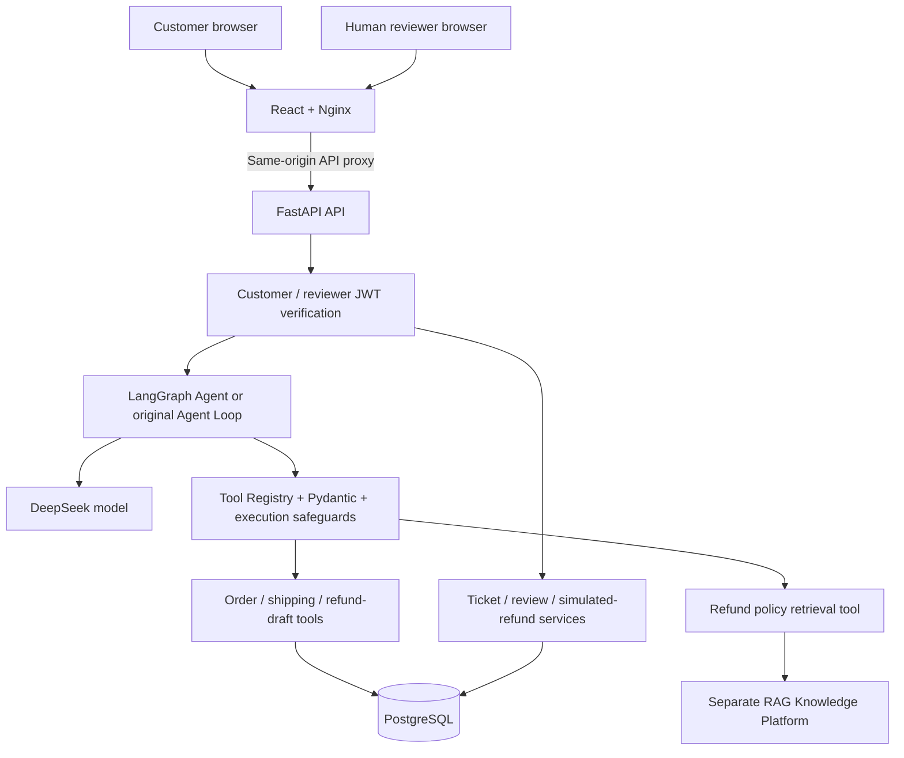
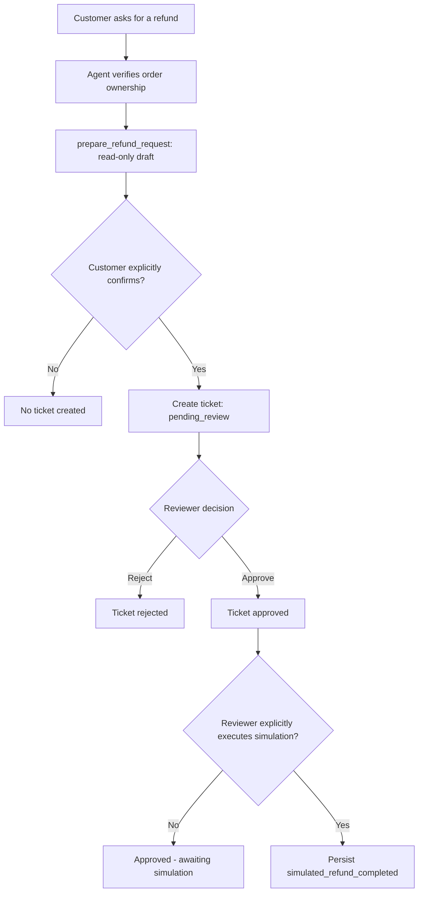

# AI Customer Support & Operations Agent

**A full-stack, production-inspired e-commerce customer support demo using DeepSeek, LangGraph, FastAPI, React, PostgreSQL, RAG, and Docker.**

The application combines natural-language order assistance with a **controlled refund workflow**: the AI can look up orders and prepare a refund-request *draft*, but **a customer must explicitly submit the request, a human reviewer must decide, and a separate action records a simulated refund**. No real money is transferred.

> **Project status (1 November 2026):** The end-to-end demo has been exercised locally, including customer login, order tool calling, refund draft, ticket submission, human approval, simulated refund, and PostgreSQL persistence. The FastAPI/LangGraph backend and React/Nginx frontend have also been built and started with Docker Compose. This is a development/demo system, **not a production payment or refund service**.

## Contents

- [What it does](#what-it-does)
- [System architecture](#system-architecture)
- [Refund lifecycle](#refund-lifecycle)
- [Technology stack](#technology-stack)
- [Docker quick start](#docker-quick-start)
- [Local development](#local-development)
- [Agent design and safeguards](#agent-design-and-safeguards)
- [Authentication and authorization](#authentication-and-authorization)
- [Data and RAG integration](#data-and-rag-integration)
- [APIs and user interfaces](#apis-and-user-interfaces)
- [Testing and verified results](#testing-and-verified-results)
- [Limitations and next steps](#limitations-and-next-steps)

## What it does

| Area                | Implemented capability                                                                                                                              |
| ------------------- | --------------------------------------------------------------------------------------------------------------------------------------------------- |
| AI assistance       | DeepSeek tool calling with LangGraph orchestration; original Python agent loop remains available behind a feature flag.                             |
| Orders and shipping | Read order and available shipping information from PostgreSQL; check customer ownership before returning private data.                              |
| Tool execution      | Allowlisted tool registry, Pydantic schemas, argument validation, duplicate-call detection, bounded execution, and structured results.              |
| Policy retrieval    | `search_refund_policy` calls the separate RAG Knowledge Platform and distinguishes retrieved evidence from insufficient evidence or service errors. |
| Customer accounts   | Customer registration/login, JWT authentication, and protected customer APIs.                                                                       |
| Refund requests     | `prepare_refund_request` produces a read-only draft. A separate, explicit customer confirmation creates a ticket.                                   |
| Human review        | Dedicated reviewer JWT, pending queue, approve/reject action, and transactional review audit record.                                                |
| Simulated refunds   | Approved tickets can move to a separately triggered simulated-refund action, with a record persisted in PostgreSQL.                                 |
| Web UI              | React customer chat/refund form and a separate reviewer console.                                                                                    |
| Deployment          | FastAPI and React/Nginx images orchestrated by Docker Compose; the demo reuses an existing host PostgreSQL database and RAG service.                |
| Tests               | Latest observed run: **115 pytest tests passed**, plus successful frontend ESLint and Vite build.                                                   |

The application includes historical public **Olist** order data and development-only demonstration orders. Olist records are *not* live merchant accounts, and the policy documents used in the RAG demo are *fictional*, not official Olist/merchant rules.

## System architecture



**Trust boundary:** an LLM can *request* use of allowlisted tools but cannot choose the authenticated customer identity, approve a refund, submit a ticket on behalf of an unconfirmed customer, or move real money. Ticket creation, human approval, and simulated refund execution are separate, authenticated application operations.

## Refund lifecycle



1. **Prepare, do not mutate:** `prepare_refund_request` validates the customer's order ownership and returns a draft containing the order ID, ticket type, refund reason, and `requires_customer_confirmation: true`. It checks for an existing simulated refund and does not create a ticket or transfer funds.
2. **Customer confirmation:** the React form displays the prepared data and requires an explicit confirmation before submitting the ticket API request. New refund tickets start as `pending_review`.
3. **Human-in-the-loop review:** an authorized reviewer views the pending queue, records a reason, and approves or rejects the request. Review status and an audit row are committed in a transaction.
4. **Separate simulated-refund execution:** only an approved ticket can be selected for the simulated action. It writes a `simulated_refunds` record with status `simulated_refund_completed`. It **never contacts a payment processor**.
5. **Visible outcome:** the customer can refresh the ticket to view review status and, if present, the simulated-refund record.

**Idempotency and integrity:** ticket creation accepts an `Idempotency-Key`; matching repeat submissions return the same ticket, whereas reuse for different content is rejected. Review actions reject duplicate final decisions. Simulated refund operations are designed to reject a second refund for the same order and to avoid duplicate writes for the same ticket. State-changing operations must be kept out of autonomous LLM tool execution.

A paid order may also have a completed *simulated* refund: original `orders.status` and the separate `simulated_refunds.status` represent different facts. The app does not rewrite the original payment into a real refunded transaction.

## Technology stack

- **Backend:** Python 3.13, FastAPI, Pydantic, SQLAlchemy ORM, psycopg, PostgreSQL, PyJWT.
- **Agent:** DeepSeek API through the OpenAI-compatible Python SDK, LangGraph, custom tool registry and execution harness.
- **Policy knowledge:** standalone RAG Knowledge Platform accessed through HTTP `POST /ask`.
- **Frontend:** React and Vite; Nginx for the containerized static build and API reverse proxy.
- **Deployment and quality:** Docker, Docker Compose, pytest, ESLint, Vite build.

## Docker quick start

The checked deployment intentionally **does not start a new PostgreSQL container or replace existing RAG volumes**. It expects two separately running development dependencies:

1. A PostgreSQL database reachable from the Windows host at port **5433**, containing the required app schema and demo data.
2. A RAG HTTP API reachable from the Windows host at port **8000**, with a configured fictional refund-policy document ID if policy lookup is required.

The application uses `POSTGRES_USER`, `POSTGRES_PASSWORD`, `POSTGRES_DB`, `POSTGRES_HOST` and `POSTGRES_PORT` to build its SQLAlchemy connection URL. Copy `.env.example` to `.env` and supply your own development credentials and API keys. **Never commit `.env`, reviewer JWTs, or live secrets.** The `.env.example` file is a template; verify it includes any variables required by your local version.

```powershell
cd D:\ai-customer-support-agent
Copy-Item .env.example .env
# Edit .env with your own credentials and existing database / RAG configuration.
docker compose config --quiet
docker compose up -d --build
docker compose ps
```

The checked `compose.yaml` overrides these container-specific settings:

```yaml
environment:
  POSTGRES_HOST: host.docker.internal
  POSTGRES_PORT: "5433"
  USE_LANGGRAPH_AGENT: "true"
  RAG_API_BASE_URL: "http://host.docker.internal:8000"
```

`host.docker.internal` refers to the Windows host **from inside Docker Desktop containers**; `localhost` from a container refers to that container. The RAG API and PostgreSQL host must permit connections from Docker. Database schemas and test records are **not** automatically migrated or seeded by Compose.

| Component                 | Local address                    | Notes                                                         |
| ------------------------- | -------------------------------- | ------------------------------------------------------------- |
| Docker customer UI        | `http://localhost:5174/`         | React served by Nginx.                                        |
| Docker reviewer UI        | `http://localhost:5174/reviewer` | Client route works on browser refresh through SPA fallback.   |
| Docker FastAPI docs       | `http://localhost:8003/docs`     | Host port `8003` maps to API container port `8002`.           |
| Existing PostgreSQL       | Windows host port `5433`         | Business data remains in the pre-existing host database.      |
| Existing RAG HTTP service | Windows host port `8000`         | Required for policy lookup, not created by this Compose file. |

The Nginx configuration proxies `/agent`, `/tickets`, `/auth`, `/reviews` and `/refunds` to `agent-api:8002` on the internal Docker network. This allows the browser to call relative API paths without exposing additional cross-origin URLs.

Useful operations:

```powershell
docker compose logs --tail=50 agent-api
docker compose logs --tail=50 frontend
docker compose restart agent-api frontend
(Invoke-WebRequest -UseBasicParsing http://127.0.0.1:8003/openapi.json).StatusCode
curl.exe -i http://127.0.0.1:5174/reviews/pending
```

An unauthenticated `/reviews/pending` request should return **HTTP 401** with `Invalid reviewer credentials`. This is a successful authentication-boundary test, not an API outage.

**Data safety:** do not run `docker compose down -v`, `docker volume rm`, or database reset commands against your existing development environment unless you explicitly intend to delete data. Container restarts alone do not delete the host PostgreSQL records. The current setup binds the web/API ports to `127.0.0.1` and is designed for local development, not Internet-facing hosting.

## Local development

For a non-Docker backend, install dependencies and point `.env` at your local PostgreSQL and RAG instances:

```powershell
cd D:\ai-customer-support-agent
python -m venv .venv
.\.venv\Scripts\Activate.ps1
python -m pip install -r requirements.txt
$env:USE_LANGGRAPH_AGENT = "true"
python -m uvicorn app.main:app --port 8002
```

In another terminal, start the React/Vite development server:

```powershell
cd D:\ai-customer-support-agent\frontend
npm.cmd install
npm.cmd run dev
```

The Vite development proxy forwards `/agent`, `/tickets`, `/auth`, `/reviews` and `/refunds` to `http://127.0.0.1:8002`. This development proxy is **not** used by a production Vite build; the Docker setup uses Nginx instead.

For a **new, intentionally empty** local database, the repository documents schema initialization and optional demonstration seeding:

```powershell
python -m app.core.init_db
python -m app.core.seed_data
```

Do **not** run initialization, seed, or import scripts blindly against an existing populated database. Review the scripts and back up data first. The provided Compose deployment does not provision PostgreSQL.

## Agent design and safeguards

The project retains both an original multi-step Python agent loop and a LangGraph implementation. Set `USE_LANGGRAPH_AGENT=true` to use LangGraph; the historical/default alternative is the original loop. The Docker demo explicitly enables LangGraph.

### LangGraph and conversation state

- **LLM node:** calls DeepSeek, handles model-service errors, and decides whether to answer or request tools.
- **Tool node:** runs allowed calls through the existing harness, never directly trusting arbitrary model instructions.
- **Conditional routing:** executes tools when pending calls exist and terminates when a final result exists.
- **Limit node:** returns a structured stop result at the configured execution boundary.
- **Conversation memory:** `InMemorySaver` uses a thread identity derived from authenticated customer ID and conversation UUID. It supports multi-turn conversations **within the running process only**.
- **Context budget:** a sliding window of recent turns and estimated token budget reduces the context sent to the model; full historical messages and paired tool responses are handled separately.

The agent loop's documented safeguards include a maximum of **4 LLM decision rounds** and **6 tool requests per run**; calls in the same round are sequential. Tool-call IDs are paired with corresponding tool responses. A duplicate or invalid tool call receives a structured error rather than direct access to a repository.

### Tool catalog

| Tool                     | Purpose                                        | Key control                                                             |
| ------------------------ | ---------------------------------------------- | ----------------------------------------------------------------------- |
| `get_order`              | Retrieve order details                         | Enforces ownership using authenticated customer context.                |
| `get_shipping_status`    | Retrieve available shipping information        | Enforces ownership; unknown carrier/tracking information stays unknown. |
| `get_ticket`             | Read an existing support ticket                | Only authorized customers may read their ticket.                        |
| `search_refund_policy`   | Query the fictional demo policy knowledge base | Uses an application-configured document ID; checks result status.       |
| `prepare_refund_request` | Prepare a refund application draft             | Read-only; no implicit submission, approval, or refund.                 |

The application deliberately separates **AI suggestions** from **authorized state-changing API operations**.

## Authentication and authorization

Customer identity is derived from a verified JWT passed through FastAPI. JWT verification checks signatures and required `sub`, `exp`, `iat`, `iss` and `aud` claims. Business repositories validate order ownership before exposing private order, shipment, or ticket data. Tool arguments supplied by the model cannot override the authenticated customer ID; Pydantic rejects unexpected arguments.

Reviewer endpoints use a **separate reviewer JWT secret, expected audience, and role**, rather than accepting a customer token. The reviewer ID used for audit is read from verified token claims, not from a request body.

- Missing, expired, forged, wrong-role, wrong-issuer, or wrong-audience tokens are rejected.
- Order access checks are designed to avoid leaking another customer's order details.
- Review transactions lock pending tickets, update their status, insert a `ticket_reviews` audit row and commit atomically; failed transactions roll back.
- A uniqueness rule prevents duplicate final review records.

**Development boundary:** reviewer tokens in this demo are issued for local testing. Reviewer account lifecycle, token revocation/rotation, rate limiting, audit monitoring, HTTPS, CSRF considerations and production permission management need additional hardening before public deployment. Do not paste tokens into documentation, screenshots, or commits.

## Data and RAG integration

### PostgreSQL and Olist

Core application tables include `orders`, `shipments`, `tickets`, `ticket_reviews` and `simulated_refunds`. Order data comes from local demonstrations and the **Olist Brazilian E-Commerce Public Dataset**. The repository's earlier ETL milestone reported importing **99,440 historical Olist orders** and preserving development orders; that count is a historical import result, not a claim about every environment.

The ETL pipeline reads historical order/payment CSVs from `data/olist/`, aggregates payment amounts with `Decimal`, imports batches of 500, and uses PostgreSQL conflict handling to avoid duplicate inserts. Documented scripts:

```powershell
python -m app.etl.preview_olist
python -m app.etl.import_olist --limit 10
python -m app.etl.import_olist
```

Raw CSV files are excluded from Git. Olist is not a live commerce integration. The import does not provide complete carrier names, tracking numbers, or independent shipment history; the agent must not invent missing fields. Demo ID formats such as `ORD-1003` coexist with historical Olist IDs.

### Refund policy RAG

`search_refund_policy` calls the separate RAG service with an application-controlled document ID:

```dotenv
RAG_API_BASE_URL=http://127.0.0.1:8000
REFUND_POLICY_DOCUMENT_ID=your_uploaded_demo_document_id
```

In Docker, `RAG_API_BASE_URL` is instead set to `http://host.docker.internal:8000`. The tool sends `POST /ask` with the question, `limit` and the configured `document_id`.

The tool reports one of several statuses:

- `retrieved`: a policy answer supported by retrieved evidence, with sources;
- `insufficient_evidence`: the request completed but evidence is not sufficient to answer;
- `service_error`: the RAG request failed;
- `not_configured`: the policy document ID is missing;
- `invalid_question`: the input is empty.

The agent must inspect the **inner `data.status`** instead of interpreting a harness `success: true` as evidence of a valid policy answer. It must not invent refund rules, deadlines, eligibility or amounts when retrieval is insufficient. **All policy text is fictional demonstration content, never official Olist or merchant policy.**

## APIs and user interfaces

The following are confirmed or documented HTTP paths; authentication requirements vary by endpoint.

| Method | Path                        | Use                                                                  |
| ------ | --------------------------- | -------------------------------------------------------------------- |
| `GET`  | `/health`                   | Backend health endpoint (documented by the project).                 |
| `POST` | `/agent/chat`               | Customer JWT-protected Agent chat.                                   |
| `POST` | `/tickets`                  | Confirmed ticket creation, with `Idempotency-Key`.                   |
| `GET`  | `/tickets/{ticket_id}`      | Authorized ticket lookup and status.                                 |
| `GET`  | `/reviews/pending`          | Reviewer-only pending refund queue.                                  |
| `POST` | `/reviews/{ticket_id}`      | Reviewer-only approve/reject action.                                 |
| `GET`  | `/reviews/ready-for-refund` | Reviewer-only queue of approved tickets pending simulated execution. |

Further authentication and simulated-refund routes are available through the running service's OpenAPI document at `/docs`; use that generated specification as the source of truth for exact route names and request schemas.

The **customer UI** handles registration/login, conversations, refund drafts, explicit submission and ticket updates. The **reviewer UI** is at `/reviewer`; an authorized reviewer can review pending applications and separately trigger simulated refund execution. The frontend labels the demo so users do not confuse a simulated refund with a real transfer.

Example JSON body for an authenticated chat:

```json
{
  "message": "Please check the status of order ORD-1003.",
  "conversation_id": "3fed4040-6eae-4d32-b958-7a7c1b27240d"
}
```

Use an actual conversation UUID generated by your client. A valid customer JWT must accompany the request. Do not infer customer identity from a user-written order ID.

## Testing and verified results

### Automated checks

```powershell
# From the repository root
python -m pytest -q

# From frontend/
cd frontend
npm.cmd run lint
npm.cmd run build
```

**Latest observed local results (Day 37 / 1 November 2026):** `115 passed` in pytest; ESLint completed without reported errors; Vite built successfully (180 modules transformed). The suite includes isolated unit/API tests that mock or override certain dependencies, so green tests do **not** by themselves prove live payment processing or production readiness.

Tests and smoke checks in this project cover, among other topics:

- JWT invalid/missing/expired tokens, roles, issuer and audience;
- Customer ownership, order/shipments access control and model-supplied identity overrides;
- Tool schema validation, duplicate calls, bounds and LangGraph integration;
- Ticket confirmation, idempotency keys and unauthorized access;
- Reviewer JWT, duplicate decisions, transactional audit and rollback;
- Simulated-refund authorization, approved-ticket requirement and duplicate prevention;
- RAG `retrieved`, insufficient evidence and service-error handling.

Historical incremental test counts (for example 14, 24, 40, 53, 62, 80 and 85) described earlier development milestones; the latest completed full run reported **115**.

### Docker end-to-end observations

The following checks were performed locally after containerization:

| Verification                                       | Observed result                                                                                                 |
| -------------------------------------------------- | --------------------------------------------------------------------------------------------------------------- |
| `docker compose build` / `up`                      | FastAPI and React/Nginx images built and containers started.                                                    |
| Backend OpenAPI over Docker port `8003`            | HTTP `200`.                                                                                                     |
| Nginx proxy to unauthenticated reviewer endpoint   | HTTP `401` with `Invalid reviewer credentials` (expected).                                                      |
| Customer login through Docker frontend             | UI entered authenticated state.                                                                                 |
| LangGraph `get_order` tool through Docker frontend | `success: true`; development order `ORD-1003`, customer `CUS-002`, amount `149.50 USD`, original status `paid`. |
| Reviewer UI through Docker frontend                | Pending queue displayed, including an existing `ORD-1001` request.                                              |
| Container-to-RAG policy tool request               | RAG returned `insufficient_evidence` (network/tool path worked; no policy answer asserted).                     |
| Docker container restart                           | Both containers returned to `Up`; API restarted normally and returned HTTP `200`.                               |
| Read-only PostgreSQL check after restart           | `ORD-1003` ticket remained `approved`; associated refund remained `simulated_refund_completed`.                 |

The completed demonstration case for `ORD-1003` was:

- Customer `CUS-002` prepared and confirmed a refund request for “商品不符合预期”.
- The ticket entered `pending_review`, was approved by a reviewer, and the simulated refund was executed in a **separate** step.
- The resulting business records were persisted to PostgreSQL and were still readable after Docker container restart.
- Original order `status=paid` is not proof of a real payment reversal; simulation status is recorded separately.

The RAG response `insufficient_evidence` must **not** be presented as a confirmed policy retrieval. A PowerShell-to-Docker test also displayed a Chinese question as question marks; full non-ASCII input handling should be independently checked before claiming internationalization coverage.

## Limitations and next steps

This repository is a substantial **locally verified demo**, not an audited, multi-tenant production SaaS or a live payments integration.

- **No real refunds or Shopify integration.** The approval and refund-execution UI work on development records only; no payment provider is called.
- **Fictional policy knowledge.** RAG demonstrations must not determine real customer eligibility.
- **Non-persistent conversation memory.** LangGraph's `InMemorySaver` loses its in-process checkpoints when the API process/container is restarted. PostgreSQL business records **do** survive in the separately managed database.
- **External dependencies.** The Docker Compose project assumes an existing host PostgreSQL server and an existing RAG HTTP service; it does not make the entire stack independently deployable on a new machine.
- **Local authentication and operations.** Reviewer token issuance and operational security are demo-level; hardening, access control lifecycle, rate limiting, TLS, health checks, observability and backup/restore procedures remain future work.
- **Historical shipping data limitations.** Missing tracking information is reported as unknown, not fabricated.
- **Testing scope.** 115 passing tests are useful regression evidence, but do not replace full integration, concurrency, load, security, or disaster-recovery testing.

Suggested future enhancements include durable LangGraph checkpoint storage, reproducible database migrations, a self-contained deployment profile for all dependencies, better CI/CD and structured observability, and explicit integration tests for Chinese policy queries.

## Responsible use

This project is for learning and demonstration. It uses historical/development data and **does not process real payments or refunds**. Keep `.env`, JWT secrets, database passwords, and test reviewer tokens out of version control. Review any deployment configuration and database operations before running them against valuable data.
